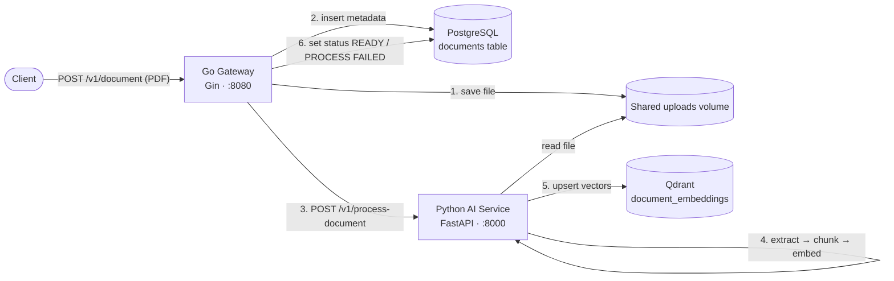

# KnowledgeHub AI

KnowledgeHub AI is the backend of a document knowledge base. You upload a PDF, and the system extracts its text, splits it into overlapping chunks, converts each chunk into a vector embedding, and stores those vectors in a vector database. That gives you the foundation for semantic search and retrieval-augmented generation (RAG) over your own documents.

It is built as two cooperating services: a fast **Go API gateway** that owns uploads and metadata, and a **Python AI service** that does the document processing and embedding work.

## Status

| Capability | State |
| --- | --- |
| PDF upload via REST API | Working |
| Document metadata + status tracking in PostgreSQL | Working |
| Text extraction, chunking, embedding, storage in Qdrant | Working |
| Semantic search / question answering endpoint | Not implemented yet |
| Frontend UI | Not implemented yet |
| Authentication and per-user documents | Not implemented yet (owner is a hard-coded demo value) |

Redis is provisioned in `docker-compose.yaml` but is not used by any service yet.

## Architecture



### Upload flow

1. The client sends a PDF as multipart form data to the gateway.
2. The gateway saves the file to `/app/uploads` (a volume shared with the Python service) and inserts a row in the `documents` table with status `UPLOADED`.
3. The gateway calls the Python service with the document ID and file path.
4. The Python service:
   - extracts the text with **PyMuPDF**,
   - splits it into chunks of 500 tokens with 100 tokens of overlap using LangChain's `RecursiveCharacterTextSplitter` (tiktoken-based),
   - creates 384-dimensional embeddings with the **`all-MiniLM-L6-v2`** sentence-transformers model,
   - stores each chunk and its vector in the Qdrant collection `document_embeddings` (cosine distance), with `document_id` and `text` in the payload.
5. The gateway updates the document status to `READY`, or `PROCESS FAILED` if processing did not succeed.

## Tech stack

| Layer | Technology |
| --- | --- |
| API gateway | Go 1.26, Gin, pgx |
| AI service | Python 3.12, FastAPI, Uvicorn |
| Embeddings | sentence-transformers (`all-MiniLM-L6-v2`, CPU-only PyTorch) |
| PDF parsing | PyMuPDF |
| Chunking | LangChain text splitters + tiktoken |
| Relational DB | PostgreSQL 17 |
| Vector DB | Qdrant |
| Cache (reserved) | Redis 8 |
| Orchestration | Docker Compose |

## Project structure

```
knowledgehub-ai/
├── docker-compose.yaml
└── backend/
    ├── go-gateway/
    │   ├── Dockerfile
    │   └── engine/
    │       ├── main.go               # entry point, starts Gin on :8080
    │       ├── common/               # request/response structs
    │       ├── db/psqldb/            # PostgreSQL connection + table creation
    │       ├── handler/              # upload handler and helper functions
    │       └── services/             # route registration
    └── python-ai-service/
        ├── Dockerfile
        ├── app.py                    # FastAPI app and endpoints
        ├── processor.py              # orchestrates the processing pipeline
        ├── pdf_reader.py             # PDF → text
        ├── chunker.py                # text → chunks
        ├── embedding.py              # chunks → vectors
        └── qdrant_collection.py      # vector storage
```

## API reference

### Go gateway (`http://localhost:8080`)

| Method | Path | Description |
| --- | --- | --- |
| `GET` | `/v1/test` | Health check |
| `POST` | `/v1/document` | Upload and process a PDF (multipart field name: `file`) |

Example:

```bash
curl -X POST http://localhost:8080/v1/document \
  -F "file=@/path/to/your.pdf"
```

Success response (`201 Created`):

```json
{
  "message": "file uploaded and processed successfully",
  "filename": "your.pdf",
  "document_id": 1
}
```

The request is synchronous: it returns only after the document has been fully embedded, so large PDFs can take a while.

### Python AI service (`http://localhost:8000`)

| Method | Path | Description |
| --- | --- | --- |
| `GET` | `/test` | Health check |
| `POST` | `/v1/process-document` | Process a stored document. Body: `{"document_id": int, "storage_path": str}` |

This service is meant to be called by the gateway, not by clients directly. FastAPI's interactive docs are available at `http://localhost:8000/docs`.

## Data model

Table `documents` (created automatically on gateway startup):

| Column | Type | Notes |
| --- | --- | --- |
| `id` | BIGSERIAL | Primary key |
| `owner_type` | VARCHAR(20) | Currently always `DEMO` |
| `owner_id` | VARCHAR(100) | Currently always `demo-session-id` |
| `filename` | TEXT | Original file name |
| `storage_path` | TEXT | Path inside the shared uploads volume |
| `file_size` | BIGINT | Bytes |
| `mime_type` | VARCHAR(100) | From the upload's `Content-Type` |
| `status` | VARCHAR(20) | `UPLOADED`, `READY`, or `PROCESS FAILED` |
| `created_at`, `updated_at` | TIMESTAMP | |

## Getting started (local)

### Prerequisites

- [Docker](https://docs.docker.com/get-docker/) with Docker Compose v2
- About 4 GB of free RAM and 5 GB of free disk space
- Internet access on first run (PyTorch is downloaded at build time, and the embedding model is downloaded when the Python service first starts)

### Run

```bash
git clone <your-repo-url> knowledgehub-ai
cd knowledgehub-ai
docker compose up -d --build
```

The first build takes several minutes because of PyTorch. Uploaded files are stored in a `knowledgehub-uploads` folder created **next to** the project folder (`../knowledgehub-uploads`).

### Verify

```bash
docker compose ps                          # all 5 containers should be running
curl http://localhost:8080/v1/test         # {"message":"status OK"}
curl http://localhost:8000/test            # {"message":"status OK"}
```

Then upload a PDF (see the example above) and check the results:

```bash
# Document status in PostgreSQL
docker exec -it postgres psql -U admin -d userdb \
  -c "SELECT id, filename, status FROM documents;"

# Vectors in Qdrant
curl http://localhost:6333/collections/document_embeddings
```

The Qdrant dashboard is available at http://localhost:6333/dashboard.

### Useful commands

```bash
docker compose logs -f go-gateway python-ai-service   # follow logs
docker compose restart go-gateway                     # restart one service
docker compose down                                   # stop (data is kept)
docker compose down -v                                # stop and delete all database data
```

## Deployment

### Deploy on a single server (VPS / EC2 / any Linux VM)

This is the simplest production-style setup, since the whole stack runs from one Compose file.

**1. Provision a server.** Ubuntu 22.04 or 24.04 with at least 2 vCPU, 4 GB RAM (8 GB is more comfortable), and 20 GB of disk. No GPU is needed.

**2. Install Docker.**

```bash
curl -fsSL https://get.docker.com | sh
sudo usermod -aG docker $USER   # log out and back in afterwards
```

**3. Get the code onto the server.**

```bash
git clone <your-repo-url> knowledgehub-ai
cd knowledgehub-ai
```

**4. Change the default credentials.** The Postgres password `password123` appears in two places and both must be updated together:

- `docker-compose.yaml` → `POSTGRES_PASSWORD`
- `backend/go-gateway/engine/db/psqldb/postgres.go` → the `connString`

**5. Stop exposing internal services.** In `docker-compose.yaml`, remove the `ports:` entries for `postgres`, `redis`, `qdrant` and `python-ai-service`. The containers still reach each other over the Compose network, but the databases are no longer open to the internet. Only the gateway (`8080`) should be reachable.

**6. Start the stack.**

```bash
docker compose up -d --build
```

Add `restart: unless-stopped` to each service in the Compose file so everything comes back after a reboot.

**7. Put HTTPS in front of the gateway.** Point a domain at the server and use a reverse proxy such as Caddy or Nginx to terminate TLS and forward to `localhost:8080`. With Caddy this is a two-line config:

```
api.yourdomain.com {
    reverse_proxy localhost:8080
}
```

**8. Open the firewall** for ports 80 and 443 only (plus SSH).

```bash
sudo ufw allow OpenSSH && sudo ufw allow 80,443/tcp && sudo ufw enable
```

**9. Smoke-test.**

```bash
curl https://api.yourdomain.com/v1/test
```

### Updating a running deployment

```bash
git pull
docker compose up -d --build
```

### Backups

- PostgreSQL: `docker exec postgres pg_dump -U admin userdb > backup.sql`
- Qdrant: back up the `qdrant-data` volume, or use Qdrant's snapshot API
- Uploaded files: back up the `knowledgehub-uploads` folder

## Known limitations

- **PDF only.** The pipeline uses PyMuPDF text extraction; scanned PDFs without a text layer will produce no usable text (no OCR).
- **Synchronous processing.** The upload request blocks until embedding finishes. A job queue (the reserved Redis service is a natural fit) would fix this.
- **Startup ordering.** `depends_on` does not wait for PostgreSQL to be ready. If the gateway starts first and logs a connection error, run `docker compose restart go-gateway`.
- **Embedding model is re-downloaded** whenever the Python container is recreated, since the Hugging Face cache is not on a volume.
- **Duplicate file names overwrite each other** in the uploads folder, because files are saved under their original name.
- **Hard-coded configuration.** Database and service addresses are set in code rather than environment variables.
- **Failed processing** returns an error to the client but does not currently update the document row to `PROCESS FAILED`.

## Roadmap

- Semantic search endpoint over the stored vectors
- Question answering over documents (RAG with an LLM)
- Authentication and per-user document ownership
- Configuration through environment variables
- Background processing with a job queue
- Support for more file types (DOCX, TXT, Markdown) and OCR
- Web frontend
